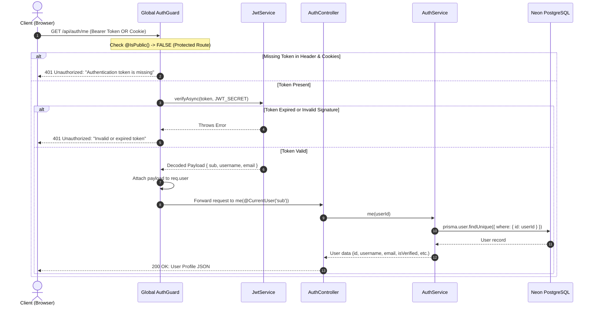
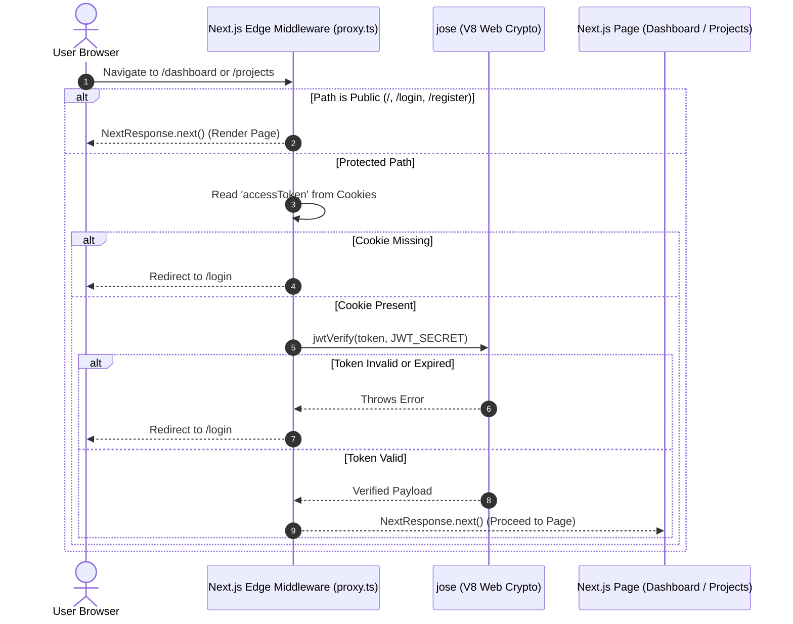

### Step 1: Pre-Registration Checks (Fast Username Availability)

_Goal: Provide instant UI feedback without overloading PostgreSQL as the user types._

- **1.1 Client Query**: The frontend sends debounced requests to `GET /api/auth/check-username?username=<input>`.
- **1.2 AuthGuard Check**: Marked with `@IsPublic()`, so request bypasses JWT validation.
- **1.3 Bloom Filter Look-up**:
  - The username is normalized (trimmed and lowercased).
  - The Bloom filter runs 3 hash functions (MD5, SHA-1, SHA-256) over its 1,000,000-bit array in memory ($O(1)$ time).
  - **Case A (Zero False Negatives)**: If any bit is `0`, the username **definitely does not exist**. Return `{ isAvailable: true }` immediately without touching PostgreSQL.
  - **Case B (Potential Match)**: If all bits are `1`, it might exist (or be a false positive). Query PostgreSQL via `prisma.user.findUnique({ where: { username } })`. If found $\rightarrow$ `{ isAvailable: false }`, else `{ isAvailable: true }`.

---

### Step 2: Request Payload Validation

_Goal: Ensure input integrity before processing._

- **2.1 Route Entry**: Client submits `POST /api/auth/register` with `username`, `email`, and `password`.
- **2.2 Global ValidationPipe Interception**:
  - Validates `RegisterAuthDto`:
    - `username`: 3–30 chars, alphanumeric + `_` / `-`. Lowercased via `@Transform`.
    - `email`: Valid RFC email format, max 255 chars, lowercased via `@Transform`.
    - `password`: String between 8 and 72 characters (72 is bcrypt's maximum byte limit).
  - Rejects malformed requests immediately with `400 Bad Request`.

---

### Step 3: Conflict & Duplication Check

_Goal: Guarantee unique accounts._

- **3.1 Database Query**:
  - `prisma.user.findFirst` searches for existing records matching `username` OR `email`.
- **3.2 Error Resolution**:
  - If `username` matches $\rightarrow$ Throws `409 ConflictException('Username is already taken')`.
  - If `email` matches $\rightarrow$ Throws `409 ConflictException('Email is already registered')`.

---

### Step 4: Password Hashing & Record Creation

_Goal: Secure storage and database persistence._

- **4.1 Password Hashing**:
  - Generates salt and hashes password with `bcrypt.hash(password, 10)`.
- **4.2 User Record Creation**:
  - Calls `prisma.user.create()`:
    - `username`: normalized username
    - `email`: normalized email
    - `passwordHash`: bcrypt hash
    - `isVerified`: Auto-set to `true` if `NODE_ENV === 'development'`, otherwise `false`.
- **4.3 Bloom Filter Immediate Reservation**:
  - Calls `this.bloom.add(user.username)`.
  - Future availability checks immediately know this username is taken without waiting for server restart.

---

### Step 5: Verification Token Generation & Async Email Queue

_Goal: Dispatch verification emails asynchronously without blocking HTTP response._

- **5.1 Production Token Generation**:
  - Generates a cryptographically secure token using `crypto.randomUUID()`.
- **5.2 Redis Storage**:
  - Sets the token in Redis at key `verify:<normalized_email>` with a **24-hour expiration** (`EX 86400`).
- **5.3 BullMQ Producer**:
  - Calls `this.mailQueue.queueVerificationEmail(user.email, token, user.username)`.
  - Enqueues job `send-verification-email` into the `mail-queue` in Redis with 3 retry attempts and exponential backoff.
- **5.4 HTTP Response**:
  - Returns `201 Created` with safe user fields (`id`, `username`, `email`, `createdAt`, `isVerified`).

---

### Step 6: Background Email Dispatch (Worker)

_Goal: Offloaded SMTP transport delivery._

- **6.1 Worker Pull**: `MailProcessor` picks up the job from BullMQ.
- **6.2 HTML Template Rendering**:
  - Calls `verificationEmailTemplate({ username, verifyLink })`.
  - Assembles HTML email containing the verification link: `${CLIENT_URL}/verify-email?token=<token>&email=<email>`.
- **6.3 SMTP Transmission**:
  - `MailService` sends the email via Nodemailer using configured `SMTP_*` transport (or log transport in dev).

---

### Step 7: Email Verification (User Link Click)

_Goal: Activate account for login._

- **7.1 Endpoint Hit**: User clicks link $\rightarrow$ `GET /api/auth/verify-email?token=...&email=...`.
- **7.2 Redis Token Validation**:
  - Fetches `storedToken` from Redis (`verify:<email>`).
  - If missing/expired $\rightarrow$ Throws `400 BadRequestException('Verification link is invalid or has expired')`.
  - If mismatch $\rightarrow$ Throws `400 BadRequestException('Invalid verification token')`.
- **7.3 User Status Update**:
  - Finds user in database. If already verified, cleans Redis token and returns success.
  - Updates database: `prisma.user.update({ where: { email }, data: { isVerified: true } })`.
- **7.4 Invalidate Token**:
  - Deletes key `verify:<email>` from Redis so the link cannot be reused.

---

### Step 8: User Login & Session Cookie Issuance

_Goal: Authenticate verified users and issue credentials._

- **8.1 Submission**: User submits `POST /api/auth/login` with identifier (`username` or `email`) and `password`.
- **8.2 User Lookup**: Searches database by username or email.
- **8.3 Credential & Status Verification**:
  - Compares password via `bcrypt.compare()`. If wrong $\rightarrow$ Throws `401 UnauthorizedException`.
  - Checks `user.isVerified`. If `false` $\rightarrow$ Throws `401 UnauthorizedException('Please verify your email before logging in')`.
- **8.4 JWT Issuance**:
  - Signs JWT payload (`sub: user.id`, `username`, `email`) using `JWT_SECRET` and `JWT_EXPIRES_IN` (7 days).
- **8.5 Cookie & Response**:
  - Sets `accessToken` into an `HttpOnly`, `SameSite` cookie (`maxAge: 7 days`).
  - Returns `{ message, user, accessToken }`.

---

### Step 9: Authenticated Protected Requests (`/api/auth/me`, etc.)

_Goal: Seamless and secure access across the app._

- **9.1 Guard Interception**: Request reaches the global `AuthGuard`.
- **9.2 Token Extraction**: Extracts token from either:
  1. `Authorization: Bearer <token>` header, or
  2. `req.cookies.accessToken` cookie.
- **9.3 Verification & Context Attachment**:
  - Verifies token via `jwtService.verifyAsync()`.
  - Attaches decoded payload to `req.user`.
- **9.4 Controller Handler**:
  - Uses `@CurrentUser('sub')` parameter decorator to cleanly access `userId` and fetch user profile data.

---

### Step 10: Edge Route Gatekeeping (Next.js Middleware with `jose`)

_Goal: Instant client-side page protection without latency-heavy network roundtrips or backend server hits._

- **10.1 Edge Route Matcher**:
  - `apps/web/proxy.ts` (Next.js middleware) intercepts all routes, excluding static assets (`_next/static`, `_next/image`, `favicon.ico`) and public auth routes (`/`, `/login`, `/register`).
- **10.2 Cookie Extraction & Edge Verification**:
  - Reads `accessToken` from `request.cookies.get('accessToken')?.value`.
  - If missing $\rightarrow$ Redirects instantly to `/login` via `NextResponse.redirect(new URL('/login', request.url))`.
- **10.3 In-Memory Signature Verification**:
  - Uses `jose.jwtVerify(cookie, JWT_SECRET)` directly in the V8 Edge runtime.
  - Secret is encoded once via `new TextEncoder().encode(process.env.JWT_SECRET)`.
  - **Zero Network Cost**: Bypasses hitting `/api/auth/me` over HTTP on every single page navigation, preventing middleware bottlenecking and false redirect loops.
  - If token signature is invalid or expired $\rightarrow$ Catches error and redirects to `/login`.
  - If valid $\rightarrow$ Allows request to proceed immediately via `NextResponse.next()`.

