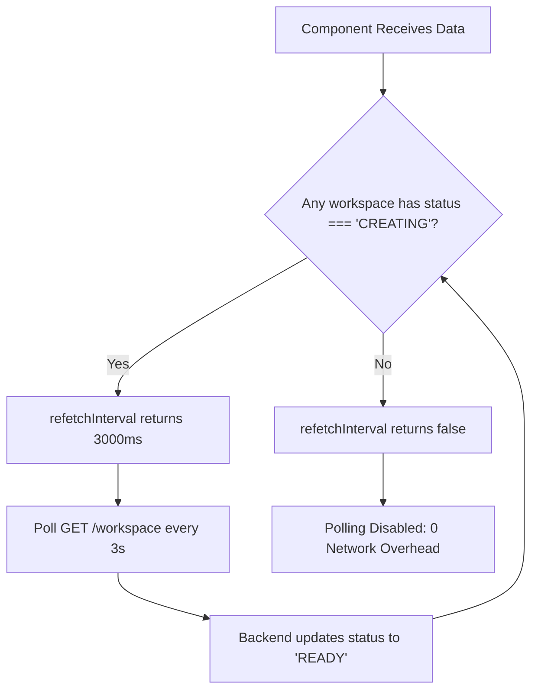
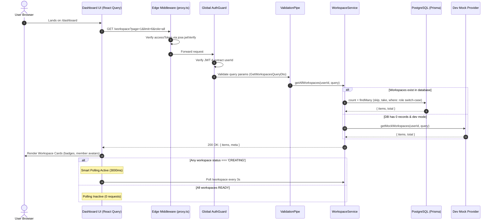

### Step 1: User Navigates to Dashboard / Projects

_Goal: Load workspaces with default pagination and initiate user-scoped query._

- **1.1 Page Mount**:
  - User lands on `/dashboard` or `/projects`.
  - Component initializes state:
    - `page = 1`
    - `limit = 6`
    - `role = 'all'`
    - `search = ''`
    - `activeCategory = 'All'`
- **1.2 Hook Trigger (`useGetWorkspacesQuery`)**:
  - Triggers TanStack Query with key: `['workspaces', 1, 6, 'all', '']`.
  - Fires API client: `GET /workspace?page=1&limit=6&role=all`.

---

### Step 2: Edge Authentication Gatekeeping

_Goal: Verify session cookie at the edge before routing reaches the application._

- **2.1 Middleware Interception (`apps/web/proxy.ts`)**:
  - Reads `accessToken` from `HttpOnly` cookie.
  - If cookie missing $\rightarrow$ Redirects instantly to `/login`.
- **2.2 In-Memory Signature Verification**:
  - Validates token using `jose.jwtVerify(token, JWT_SECRET)` in the V8 Edge runtime.
  - If valid $\rightarrow$ Request proceeds with zero network roundtrip latency.
  - _(Full details in [1. auth.md (Step 10)](file:///Users/riticklath/collabcode/packages/doc/1.%20auth.md))_

---

### Step 3: Backend Request Interception & DTO Validation

_Goal: Strict query whitelist check before database execution._

- **3.1 Global `ValidationPipe` Interception**:
  - Target: `GET /workspace`.
  - Validates `GetWorkspacesQueryDto`:
    - `page`: Number (defaults to 1, minimum 1).
    - `limit`: Number (defaults to 6, maximum 50).
    - `role`: Enum strictly matching `'all' | 'owner' | 'member'`.
    - `search`: String (optional search query).
  - Any unauthorized parameters (e.g., malformed `params[page]`) are rejected immediately with `400 Bad Request`.
- **3.2 Context Extraction**:
  - Global `AuthGuard` validates Bearer/cookie token and attaches user payload.
  - `@CurrentUser('sub')` decorator extracts the authenticated `userId`.

---

### Step 4: Role-Based Query Construction (`switch-case`)

_Goal: Ensure correct data isolation between owned and shared workspaces._

- **4.1 Role Filter Resolution**:
  - In `WorkspaceService.getAllWorkspaces`, a `switch (query?.role)` statement builds the Prisma `where` clause:
    - `case 'owner'`: `{ ownerId: userId }` $\rightarrow$ Workspaces created by the user.
    - `case 'member'`: `{ ownerId: { not: userId }, members: { some: { userId } } }` $\rightarrow$ Workspaces created by others where the user was invited as a collaborator.
    - `case 'all'` / `default`: `{ OR: [{ ownerId: userId }, { members: { some: { userId } } }] }` $\rightarrow$ Union of owned and shared workspaces.
- **4.2 Text Search Appending**:
  - If `query.search` is present:
    - Wraps `whereClause` with an `AND` condition querying `{ name, framework, description }` with `mode: 'insensitive'`.

---

### Step 5: Database Execution & Dev Mock Fallback

_Goal: Retrieve paginated workspaces with member relations, or serve realistic mocks in dev._

- **5.1 Database Fetch**:
  - Executes concurrently via `Promise.all`:
    1. `prisma.workspace.count({ where: whereClause })`
    2. `prisma.workspace.findMany`:
       - `skip: (page - 1) * limit`
       - `take: limit`
       - `orderBy: { updatedAt: 'desc' }`
       - `include`: Joins `owner` (id, username, email) and `members.user` (id, username, email).
- **5.2 Dev Mock Fallback (Zero-Data Safety)**:
  - If `total === 0` and `process.env.NODE_ENV !== 'production'`:
    - Calls `getMockWorkspaces(userId, query)` from `common/mock/workspace.mock.ts`.
    - Returns realistic workspaces (Next.js, Vite, FastAPI, Express) with collaborative member avatars.
- **5.3 Response Structure**:
  - Returns `PaginatedWorkspacesResponse`:
    ```json
    {
      "items": [/* workspace records with owner and members */],
      "meta": {
        "page": 1,
        "limit": 6,
        "total": 4,
        "totalPages": 1,
        "hasNextPage": false,
        "hasPrevPage": false
      }
    }
    ```

---

### Step 6: Client Data Presentation & Card Rendering

_Goal: Render rich cards with framework branding, ownership badges, and member avatars._

- **6.1 Category Slicing**:
  - Client applies instant category switch (`activeCategory`):
    - `Frontend`: React, Vite, HTML.
    - `Fullstack`: Next.js.
    - `Backend`: Node.js, Python, FastAPI, NestJS.
    - `Git`: Workspaces imported from Git URL.
- **6.2 Card Display (`WorkspaceCard`)**:
  - **Ownership Badge**: Shows `👑 You (Owner)` if `workspace.ownerId === currentUser.id`, otherwise displays `Owner: @username`.
  - **Member Avatars**: Stacked circular avatars with uppercase initials.
  - **Hover Tooltip**: Hovering over an avatar displays the collaborator's `@username`.
  - **Status Indicator**: Green dot for `READY`, animated pulsing amber spinner for `CREATING`.

---

### Step 7: Smart Dynamic Polling

_Goal: Zero background network overhead when idle, fast reactive updates during provisioning._

- **7.1 State Check via Query Callback**:
  - In `useGetWorkspacesQuery`, `refetchInterval` is defined as a function:
    ```typescript
    refetchInterval: (query) => {
      const data = query.state.data as PaginatedWorkspacesResponse | undefined
      const hasPending = data?.items?.some((w) => w.status === "CREATING")
      return hasPending ? 3000 : false
    }
    ```
- **7.2 Condition A: Any Workspace is Provisioning (`hasPending === true`)**:
  - Returns `3000` (polls every 3 seconds).
  - Keeps polling until the backend completes scaffolding and updates status to `READY`.
- **7.3 Condition B: All Workspaces are Provisioned (`hasPending === false`)**:
  - Returns `false`.
  - Polling completely stops — zero requests sent to the server.



---

### Step 8: User Filters by Role or Searches

_Goal: Interactive filtering with automatic pagination reset._

- **8.1 User Action**:
  - User clicks **"Owner"** tab $\rightarrow$ `setRoleFilter('owner')`, `setPage(1)`.
  - Or user types in search bar $\rightarrow$ `setSearch('api')`, `setPage(1)`.
- **8.2 React Query Cache Key Update**:
  - Cache key updates to `['workspaces', 1, 6, 'owner', 'api']`.
  - React Query triggers fetch for new parameters, displaying filtered results.

---

### Step 9: User Changes Page (Pagination)

_Goal: Seamless navigation across large workspace sets._

- **9.1 Navigation Trigger**:
  - User clicks **Next Page** on `WorkspacePagination`.
  - `setPage((p) => p + 1)`.
- **9.2 Query Execution**:
  - Cache key becomes `['workspaces', 2, 6, 'all', '']`.
  - React Query fetches items `skip = 6, take = 6`.
  - UI smoothly updates cards with page 2 data.

---

### Step 10: Workspace Creation Modal (Template vs Git)

_Goal: Create new project and start automatic provisioning flow._

- **10.1 Modal Open**:
  - User clicks **"New Project"** button $\rightarrow$ Opens `CreateWorkspaceModal`.
- **10.2 Selection**:
  - **Tab 1 (Templates)**: User selects starter framework (Next.js, Vite, FastAPI, Express, NestJS) and enters workspace name.
  - **Tab 2 (Import Git)**: User enters Git repository URL and workspace name.
- **10.3 Submission & Invalidation**:
  - Calls `useCreateWorkspaceMutation`:
    - Template: `POST /workspace`
    - Git: `POST /workspace/git`
  - On `201 Created`:
    - Shows success toast.
    - Calls `queryClient.invalidateQueries({ queryKey: ['workspaces'] })`.
    - New workspace appears on dashboard with `status: 'CREATING'`.
    - **Smart Polling (Step 7) automatically wakes up** (3000ms) until provisioning finishes.

---

## Complete Sequence Diagram


